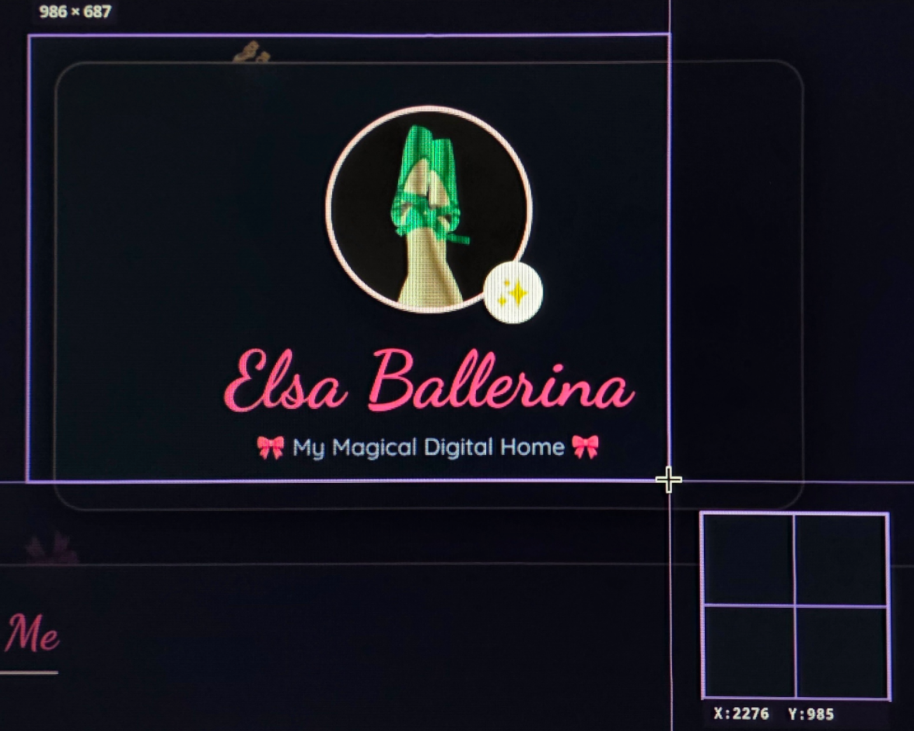
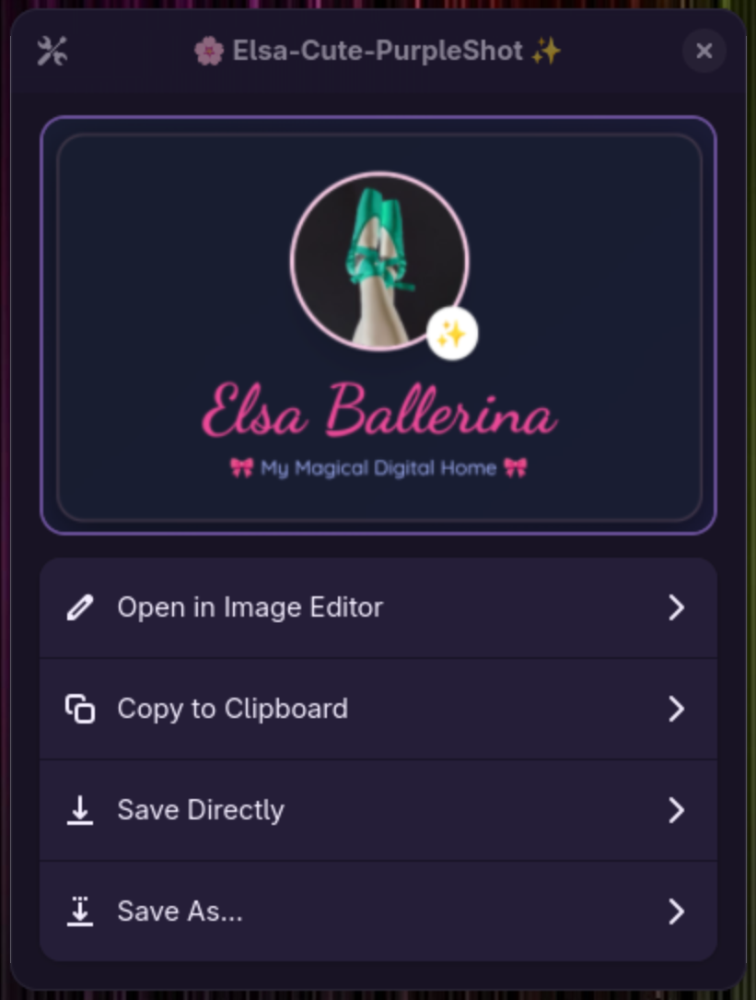
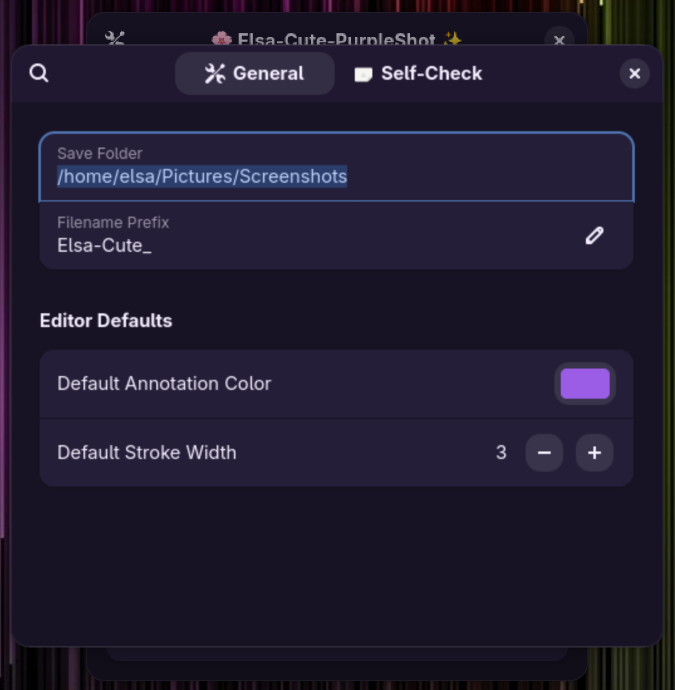
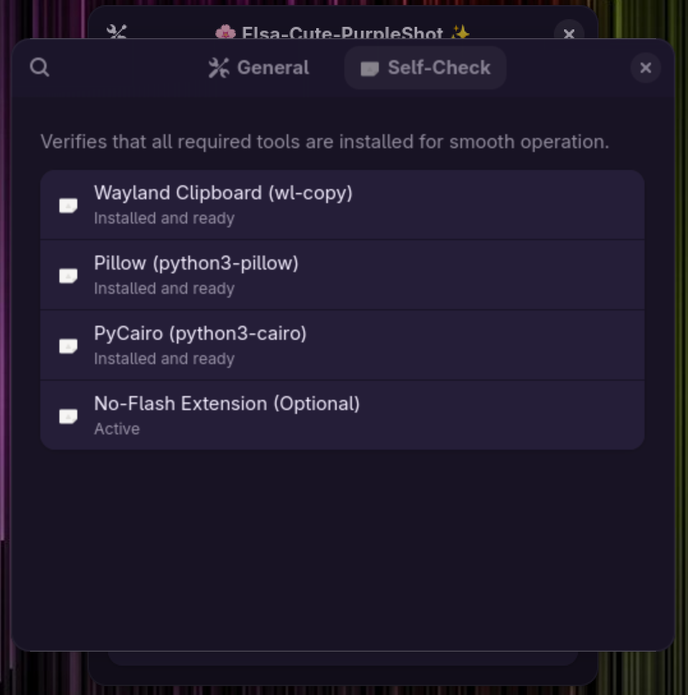

# 🌸 Elsa-Cute-PurpleShot v1.0 ✨

A cute, dark-purple, Fedora-native screenshot and annotation utility inspired by Greenshot—built with **Python 3, GTK4, Libadwaita, and Cairo** for GNOME on Wayland.

## ✨ Features
- **Multi-Monitor 1:1 Region Capture** with purple crosshairs and a smooth 5x pixel zoom scope.
- **Post-Capture Destination Picker** (Open in Image Editor, Copy to Clipboard via `wl-copy`, Save Directly, Save As).
- **Vector Annotation Editor** with Freehand Pen, Arrows, Rectangles, Ellipses, Lines, Highlighter, Text, Step Counters, Pixelate/Obfuscate, Crop, Resize, Drop Shadow, and Torn-Edge borders.
- **Editor Shortcuts:** `Ctrl+Z` (Undo), `Ctrl+Y` (Redo), `Ctrl+C` (Copy), `Ctrl+S` (Save), `Delete` (Remove selected).
- **Built-in Settings & Self-Check** to verify system dependencies and customize your save folder, filename prefix (`Elsa-Cute_`), and default pen color.

## 📸 Screenshots

### Region Capture & 5x Zoom Scope

### Main View & Destination Picker

### General Settings

### System Self-Check

## 🚀 Installation (Fedora Workstation)

    git clone https://github.com/elsaballerina/Elsa-Cute-PurpleShot.git
    cd Elsa-Cute-PurpleShot
    ./install.sh

## 💡 Usage
- **Capture Region:** `python3 /path/to/Elsa-Cute-PurpleShot --capture`
  *(Tip: Bind this command to `Shift+Super+S` or `Print` in GNOME Settings → Keyboard → Custom Shortcuts.)*
- **Open Settings & Self-Check:** `python3 /path/to/Elsa-Cute-PurpleShot --settings` (or click **🌸 Elsa-Cute-PurpleShot ✨** in your GNOME app grid).

## 🧹 Uninstall

    ./uninstall.sh

## 📄 License
This project is licensed under the [MIT License](LICENSE).
